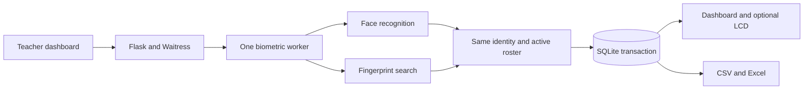

# Architecture and requirement mapping

The teacher's browser talks to a Flask application served by Waitress. A single worker owns camera/fingerprint operations. SQLite transactions own the final attendance decision. Hardware libraries are imported only when needed, so simulation runs on a laptop without Pi modules installed.

## Code responsibilities

| File | Responsibility |
|---|---|
| `attendance/config.py` | Explicit runtime profile and validated settings |
| `attendance/database.py` | Students, one active session, roster snapshot, audit, transactional duplicate prevention, fingerprint replacement and cleanup journal |
| `attendance/runtime.py` | Serialized enrollment/scan jobs, cancellation, per-attempt evidence, timeouts, feedback |
| `attendance/devices/camera.py` | Laptop VideoCapture / Pi Picamera2, consistent BGR frames, transient preview |
| `attendance/devices/face.py` | Haar detection, quality checks, LBPH identity models, unknown/ambiguity rejection |
| `attendance/devices/sface.py` | YuNet landmarks, aligned SFace embeddings, backward-compatible grayscale enrollment loading |
| `attendance/face_models.py` | Explicit installation and SHA-256 verification of public OpenCV Zoo models |
| `attendance/devices/fingerprint.py` | R307 EF01 UART, password verification, index bitmap, two-image enrollment and search |
| `attendance/devices/feedback.py` | Dashboard prompts/results, optional HD44780 I²C 16×2 LCD, retry and output cleanup |
| `attendance/web.py` | Teacher password authentication, CSRF, APIs and report access |
| `attendance/reports.py` | Timezone conversion, CSV/XLSX, spreadsheet formula escaping |
| `attendance/locking.py` | Cross-platform server/maintenance process lock |
| `scripts/hardware_test.py` | Independent component bring-up, no attendance writes |

## Source requirements and component changes

The supplied project proposal is a requirements source. Its descriptions of the intended product were used as project context; they are not independent instructions to perform external actions. The user's purchased components override the proposal's USB webcam, AS608 and OLED assumptions.

| Proposal requirement | Implementation |
|---|---|
| Student ID, roll, name and biometric association | SQLite ID, unique roll, face sample file keyed by ID, unique sensor slot |
| Teacher selects class and subject/session | Authenticated local web dashboard |
| Both checks independently identify the same student | Separate face ID and sensor-slot-to-student lookup, equality check |
| Missing/failed/timed-out biometrics cannot mark attendance | Per-attempt deadline, exceptions converted to rejection, no stale identity cache |
| Correct active session and no duplicates | Session captured when scan starts; transaction rechecks active ID, roster, uniqueness |
| Feedback on success/failure | Dashboard in every mode and an available 16×2 I²C LCD on the Pi |
| Digital records and Excel-compatible reports | SQLite, CSV and XLSX, class roster with Pending/Absent status |
| Portable operation | Offline runtime, non-root systemd service example, LAN teacher interface |
| Pi module camera | Picamera2 through the current libcamera stack |
| RS307 fingerprint sensor | R307/R30x protocol adapter pending exact product confirmation |

## Attendance invariants

There is no web endpoint for directly marking a student present. Hardware mode accepts scan commands but rejects supplied simulated identities. Face samples and sensor matches are acquired on the server.

Each scan starts with both identities unset. The server sets an overall deadline and stage deadlines. After both checks, an immediate SQLite transaction checks the captured session against the current active session, requires equal non-null IDs, requires both enrollments, checks the roster and the unique student/session pair, and writes the row plus audit outcome. Concurrent duplicate requests can accept at most one row.

Face timeout, serial failure and cancellation reject the attempt. Changing/closing a session invalidates a scan that has not committed. Each sensor search requires removal before a new placement. No cached fingerprint match can complete the next attempt.

Prompts are displayed during capture and results after the database decision. The dashboard always receives the display lines before any LCD access. LCD initialization, write and cleanup failures are contained within the feedback adapter, allowing biometric operations to continue. With LCD use enabled, a failed display is retried after five seconds on a subsequent operation. The dashboard exposes its connection status and warning. Accepted rows remain committed, and a repeated successful scan is rejected as a duplicate. Device diagnostics check camera/fingerprint hardware and show display status without creating attendance.

## Data and maintenance

The database has `students`, `sessions`, `roster`, `attendance`, `attempts`, `metadata` and `fingerprint_cleanup` tables. All stored timestamps are UTC; the dashboard and reports use `Asia/Kolkata` by default. `roster` snapshots roll/name at session creation. Changing student registration is disallowed through the interface while a session is active.

`faces/<student_id>.npz` contains 160×160 grayscale crops for LBPH/older enrollments, or 112×112 aligned BGR crops for new SFace enrollments. SFace also reads older grayscale crops and computes landmarks/features in memory, leaving the archive untouched. Archives use `allow_pickle=False` and validate image shape, dtype and count. Saves flush to disk and replace the old archive atomically. Models/features are cached by file metadata and rebuilt on restart or recapture. Runtime startup loads enrollment before a timed scan; the authenticated dashboard checks the actual archives separately from database flags.

Model weights in `models/` are public, downloaded by the explicit `setup-face-models` command, SHA-256 verified, and ignored by Git. Recognition never downloads models or uploads face data. The profile's relative data/model paths are resolved against the config file. Fingerprint images/templates remain in the sensor. Enrollment avoids existing/reserved slots and rejects a finger already stored for another student. Re-enrollment permits the selected student's current finger and stores the replacement in a free slot.

Before sensor storage, a candidate slot is recorded in `fingerprint_cleanup` with no student association. After the sensor acknowledges storage, one SQLite transaction checks the previous mapping and session state, installs the new mapping, removes the candidate journal entry and queues the old template with its student association. Cleanup checks occupied slots, deletes retired or unfinished templates and removes completed journal entries. Slots assigned to current students are preserved. Pending retired templates retain their student association until deletion succeeds, allowing matching when a same-finger recapture leaves both templates on the sensor after a deletion failure. The dashboard warns about pending cleanup. Enrollment, scans and diagnostics retry it, including after restart. Existing databases gain the recovery table automatically.

One process must own a set of physical hardware. The CLI prevents a second process using the same data directory, but two separately configured data directories could still address the same hardware. Do not run them simultaneously. Backup/password maintenance also uses this lock.

## Extending the prototype

Both real-camera profiles select the same SFace implementation, model files, thresholds and persistent enrollment format. The Pi uses the ARM64 OpenCV 4.11 headless wheel with the OS NumPy retained for Picamera2; the laptop uses its own pinned dependencies. LBPH remains an explicitly selectable legacy backend, but neither shipped real-camera profile defaults to it. Matching scales linearly with saved templates and preserves the `enroll`/`identify` and database transaction rules. Calibrate with a larger population before expanding use. Face liveness is not implemented. A different fingerprint protocol belongs behind a separate adapter; preserve the attendance rule when replacing a device.

Automated tests check decision rules, concurrency, API authorization, CSRF, mode isolation, report generation, OpenCV sample/model handling, UART packets, checksums, fragmented reads, timeout, enrollment and duplicate-finger protection. Physical device tests and measured biometric accuracy remain separate acceptance work on the actual hardware.
