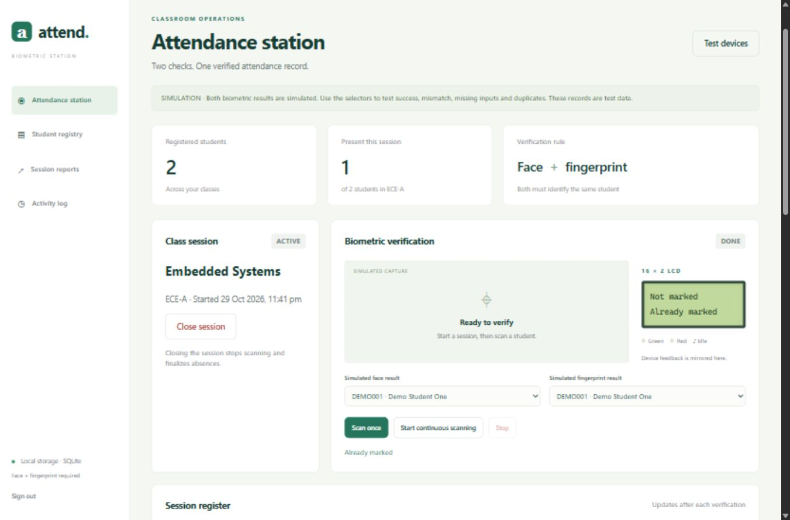
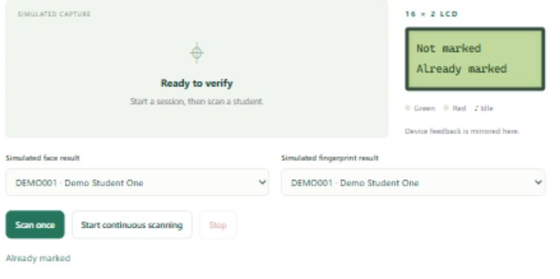

# Smart Attendance System Progress Report

**Report date: 3 November 2026**

## Project status and system design

We have built a local attendance prototype with face and fingerprint verification, student enrollment, class sessions, and report exports. Software checks have been completed in the Windows environment. Raspberry Pi OS and the required libraries have been downloaded, and physical hardware integration is the next phase.

### Project objective

The system is designed to reduce manual attendance recording and make proxy attendance more difficult by requiring two independent biometric checks. A student is marked Present only when the face and fingerprint identify the same enrolled student in the active class. The application also records rejected attempts so the teacher can review failures without adding incorrect attendance.

### Progress by work area

| Work area | Deliverable completed | Current status |
| --- | --- | --- |
| Teacher interface | Dashboard, registry, sessions, reports | Implemented |
| Biometric software | Face matcher and fingerprint driver | Implemented |
| Attendance records | SQLite storage and Excel/CSV exports | Implemented |
| Software verification | 46 automated tests and browser checks | Recorded as passed |
| Hardware preparation | OS and required library downloads | Completed |
| Physical prototype | Wiring and combined device operation | Pending validation |

### How the system is organized

The browser connects to a Python application built with Flask and served by Waitress. A single background worker controls biometric operations, preventing overlapping camera and fingerprint jobs. SQLite checks the active session, class membership, biometric agreement, and duplicate status before saving attendance. Device feedback follows the database decision.

*Figure 1. The software checks both identities and the session before accepting attendance.*

### Operating profiles

Three configurations support development and deployment. Simulation mode uses simulated face and fingerprint results. Laptop mode uses a real webcam with a simulated fingerprint. Raspberry Pi mode uses Picamera2, the UART fingerprint reader, and physical feedback devices. Each profile uses a separate data directory; hardware mode rejects simulated identity inputs.

<!-- pagebreak -->

## Software implementation

### Teacher dashboard and enrollment

The dashboard provides password-protected access to the attendance station, student registry, session reports, and activity log. The teacher registers each student's roll number, name, and class, then enrolls both biometrics before starting a session. Registration and enrollment are locked while a session is active, preserving the roster used for that class.

The interface supports a single scan or continuous scanning for a queue of students. It displays the current session, scan outcome, attendance counts, and feedback messages. A camera preview is available during real capture operations, and the dashboard mirrors the LCD and indicator state.

### Face recognition

Face enrollment and identification use OpenCV with Local Binary Patterns Histograms (LBPH). The module detects a face, checks image quality, and stores normalized grayscale samples locally. The default enrollment configuration collects 20 samples. Recognition uses a distance threshold, a margin from the next-best candidate, and repeated matching frames to reject weak or ambiguous results.

Camera adapters support the laptop webcam and the Pi camera through Picamera2. The default thresholds are starting values for calibration. Recognition accuracy under the intended classroom lighting has not yet been measured.

### Fingerprint recognition

The UART driver implements the documented R307/R30x protocol for sensor communication, enrollment, and identification. Enrollment captures the same finger twice, checks for an existing template, selects an available sensor slot, and associates that slot with a student. Fingerprint templates remain in sensor storage; the application stores the student-to-slot mapping.

Each identification attempt requires a fresh finger placement. Unknown, weak, or unmapped matches are rejected. The exact sensor sold as RS307 still needs its protocol, pinout, and voltage requirements confirmed before physical use.

### Attendance decision and record handling

1. The teacher selects a class and subject and starts a session. The system saves a snapshot of that class roster.
2. A scan acquires the face identity and then the fingerprint identity. Both results belong to that attempt.
3. The system requires matching identities, completed enrollment, membership of the active class, and no earlier attendance for that student in the same session.
4. An accepted result creates one timestamped attendance record. Rejected attempts appear in the activity history without creating attendance.
5. Closing the session finalizes remaining students as Absent. The teacher can export the full register to Excel or CSV.

### Reports and maintenance

Reports include roll number, name, class, subject, session date, attendance time, method, status, and operating mode. Stored timestamps use UTC, with local display and reporting configured for Asia/Kolkata. The application includes dependency diagnostics, backup support, and protection against a second process opening the same data directory for server or maintenance work.

<!-- pagebreak -->

## Dashboard demonstration

The saved dashboard view below comes from the documented simulation checks. It shows two demo students, an active ECE-A session for Embedded Systems, and one accepted attendance record. The latest attempt was rejected as a duplicate, leaving the present count at one. All visible student records are demonstration data.

*Figure 2. Saved attendance station view with class controls, counts, and biometric verification.*

### Verification controls and feedback

The verification panel provides the simulated input selectors, Scan once, Start continuous scanning, and Stop controls. The LCD preview displays the latest outcome. In the example, both selectors refer to Demo Student One, but that student's attendance already exists in the session; the panel therefore reports Already marked.

*Figure 3. Close-up from the same saved view showing duplicate rejection and the LCD message.*

<!-- pagebreak -->

## Hardware preparation and integration

### Preparation completed

**I have downloaded Raspberry Pi OS and the required libraries for the hardware setup.** The project also includes the Raspberry Pi configuration, dependency lists, hardware adapters, a wiring guide, component test scripts, and an example startup service. These materials provide the software and instructions needed to assemble and test the physical prototype.

### Components and intended roles

| Component | Role in the system | Integration status |
| --- | --- | --- |
| Raspberry Pi 4 | Runs the application and local database | OS downloaded; boot to verify |
| Raspberry Pi camera | Captures enrollment and scan images | Picamera2 adapter ready |
| RS307 fingerprint sensor | Enrolls and identifies fingerprints | UART driver ready; model to confirm |
| 16 x 2 I2C LCD | Displays prompts and scan outcomes | Display adapter ready |
| Green and red LEDs | Indicate accepted or rejected attempts | GPIO control ready |
| Buzzer | Provides audible feedback | Active/passive settings available |

Physical operation of these components has not yet been validated. The table describes the implemented software and intended hardware roles.

### Required software and interfaces

The Pi environment uses OpenCV and NumPy for face processing, Picamera2 for camera capture, pyserial for fingerprint communication, RPLCD and SMBus for the LCD, and GPIO Zero for LEDs and the buzzer. Flask, Waitress, and openpyxl support the dashboard and report exports. The next software check is to confirm that these dependencies load correctly on the Pi.

The wiring plan uses the camera's CSI connection, UART for the fingerprint sensor, and I2C for the LCD. Green, red, and buzzer outputs are configured on BCM GPIO17, GPIO27, and GPIO22. The LCD address must be detected on the actual device, and the fingerprint sensor settings must match its documentation.

### Integration sequence

1. Complete or verify the Raspberry Pi OS installation, boot, clock, and required library imports.
2. Confirm the sensor pinout, supply and signal voltages, and buzzer type. Follow the guide's level shifting, LED resistor, and buzzer driver arrangements.
3. Enable the required interfaces, connect the components with power disconnected, and run the camera, LCD, GPIO, and fingerprint tests individually.
4. Deploy the application with the Raspberry Pi profile and enroll real face and fingerprint records on the device.
5. Run complete attendance sessions and verify records, display messages, LEDs, and sound before enabling automatic startup.

<!-- pagebreak -->

## Testing and remaining work

### Verification completed

The verification record dated **29 October 2026** reports **46 passing automated tests** in the Windows environment using Python 3.12.14. Python compilation, JavaScript syntax checks, dependency consistency checks, and the laptop diagnostic command also passed. These are the recorded verification results for the software prototype.

| Test area | Coverage recorded |
| --- | --- |
| Attendance rules | Matching inputs, mismatches, missing/unknown identities, wrong class, and enrollment checks |
| Sessions and duplicates | Session changes, concurrent duplicate prevention, roster snapshots, and a single active session |
| Access and reports | Teacher login, CSRF protection, protected exports, Pending/Absent status, and spreadsheet escaping |
| Fingerprint protocol | Packets, checksums, fragmented reads, timeouts, enrollment, occupied slots, and weak-match rejection |
| Device and runtime behavior | Cancellation, camera/serial failures, simulated GPIO/LCD contracts, and committed records after feedback failure |

Browser checks confirmed teacher sign-in, session creation, a successful simulated dual check, mismatch rejection, duplicate rejection, and attendance counts. The interface was inspected at narrow and laptop viewports; the recorded final page had no browser console warnings or errors.

### Physical acceptance criteria

The next demonstration should confirm that a correctly enrolled face and finger create exactly one Present record with the expected device feedback. Repeating that scan must leave one record. Mismatched, missing, unknown, and wrong-class inputs must create no attendance. Closing a session or disconnecting a device during an uncommitted attempt must not produce an invalid record.

Enrollment persistence after reboot, completed-session exports, correct timestamps, and physical LCD, LED, and buzzer behavior also need to be checked on the Pi.

### Evaluation and remaining milestones

After component integration, we will test enrolled and unknown participants under the intended lighting conditions. The evaluation should record correct accepts, false accepts, rejections, and scan duration, together with the number of trials and test conditions. The laptop guide proposes repeated trials under normal and changed lighting, unknown-person trials, and deliberate face/fingerprint mismatches.

The remaining milestones are hardware bring-up, real biometric enrollment, complete session testing, threshold calibration, and a final demonstration with exported attendance records. No measured biometric accuracy or scan-time claim is available yet. The current LBPH prototype does not include face liveness detection.

### Supporting project records

The implementation and verification details are documented in the project README, Architecture and requirement mapping, Verification record, Raspberry Pi setup and wiring plan, and Laptop testing guide. The dashboard illustrations reproduce the saved simulation view used in the verification record.
